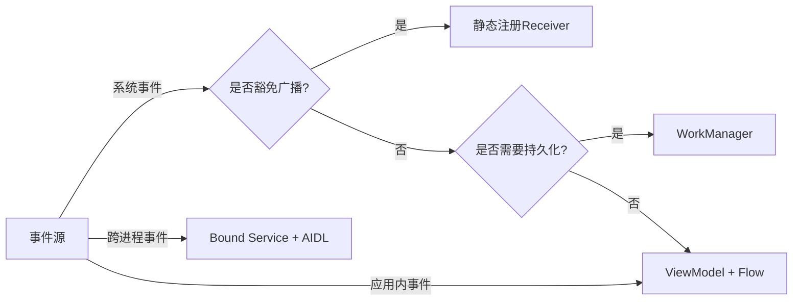
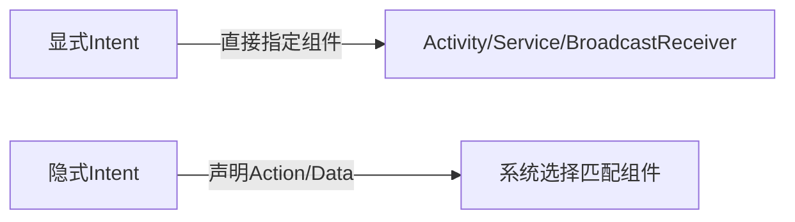
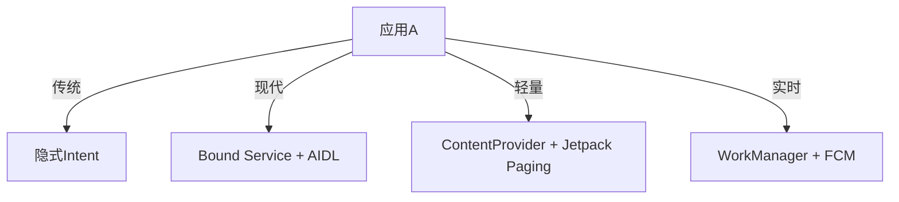

# Android开发中的Activity用法

在当前时间（2026年1月5日），虽然Android开发技术栈已有不少变化，但Activity作为四大组件之一，仍然是构建Android应用界面的核心基础。以下是对Activity用法的详细说明：

## 1. Activity的基本概念
Activity是Android中负责用户界面交互的组件，代表应用中的一个单一屏幕。每个Activity通常对应一个用户界面，提供与用户互动的功能。

## 2. Activity生命周期
Activity拥有完整的生命周期，关键方法包括：
```kotlin
override fun onCreate(savedInstanceState: Bundle?) // 初始化Activity
override fun onStart() // Activity可见但不可交互
override fun onResume() // Activity可交互
override fun onPause() // 失去焦点但仍然可见
override fun onStop() // 不再可见
override fun onDestroy() // Activity被销毁
override fun onRestart() // 从停止状态重启
```

## 3. 创建Activity
### 基本步骤
1. 创建继承自`AppCompatActivity`的类
2. 重写`onCreate()`方法
3. 设置布局（使用XML或Jetpack Compose）
4. 在AndroidManifest.xml中注册

```kotlin
class MainActivity : AppCompatActivity() {
    override fun onCreate(savedInstanceState: Bundle?) {
        super.onCreate(savedInstanceState)
        // XML方式
        setContentView(R.layout.activity_main)
        
        // 或Compose方式
        setContent {
            MyAppTheme {
                MainScreen()
            }
        }
    }
}
```

## 4. Activity间导航
### 启动新Activity
```kotlin
// 启动新Activity
val intent = Intent(this, SecondActivity::class.java)
startActivity(intent)

// 带返回结果
startActivityForResult(intent, REQUEST_CODE)

// 现代方法(2026年推荐)
registerForActivityResult(ActivityResultContracts.StartActivityForResult()) { result ->
    if (result.resultCode == RESULT_OK) {
        // 处理返回结果
    }
}
```

### 传递数据
```kotlin
// 传递数据
intent.putExtra("key", "value")
intent.putExtra("user", user) // 需要实现Serializable或Parcelable

// 接收数据
val value = intent.getStringExtra("key")
val user = intent.getParcelableExtra<User>("user")
```

## 5. 启动模式
在AndroidManifest.xml中配置：
```xml
<activity
    android:name=".MyActivity"
    android:launchMode="standard|singleTop|singleTask|singleInstance">
</activity>
```
- **standard**: 默认模式，每次启动创建新实例
- **singleTop**: 如果目标Activity已在栈顶，重用而非创建
- **singleTask**: 确保Activity在任务栈中只有一个实例
- **singleInstance**: 在单独任务栈中创建唯一实例

## 6. 现代Android开发中Activity的角色
截至2026年，Google推荐的架构中：
- Activity主要作为导航容器和生命周期管理者
- UI逻辑更多移至Fragment或Jetpack Compose
- ViewModel用于管理UI相关数据，与Activity生命周期解耦
- Navigation Component简化Activity/Fragment间导航

## 7. 最佳实践
1. 保持Activity精简，将业务逻辑移至ViewModel或其他类
2. 使用依赖注入（如Hilt）管理依赖
3. 考虑使用单一Activity架构，结合Navigation Component和Fragment/Compose
4. 适配不同屏幕配置（横竖屏、折叠屏等）
5. 正确处理配置变更和状态保存

Activity虽然仍是Android开发的核心组件，但随着Jetpack Compose的普及和架构演进，现代应用趋向于更精简的Activity设计，将更多功能委托给其他组件。

#  Android开发中的Service用法

截至2026年1月，随着Android系统不断强化后台限制（特别是Android 14+的严格后台执行限制），Service组件的使用方式已发生显著变化。虽然仍是四大组件之一，但现代开发中更推荐使用替代方案。以下是Service的核心用法和现代实践指南：

## 1. Service的核心概念
Service是在后台执行长时间运行操作的组件，**无用户界面**。典型场景包括：
- 音乐播放
- 文件下载/上传
- 位置跟踪
- 网络通信

> 📌 **2026年关键变化**：Android 14+已禁止大多数后台Service启动，除非应用在前台或满足特定豁免条件。

## 2. Service生命周期
```kotlin
class MyService : Service() {
    override fun onCreate() { /* 首次创建时调用 */ }
    override fun onStartCommand(intent: Intent?, flags: Int, startId: Int): Int { 
        /* 每次startService()调用 */
        return START_STICKY // 系统杀死后自动重启
    }
    override fun onBind(intent: Intent): IBinder? { 
        /* 绑定Service时调用 */
        return null 
    }
    override fun onDestroy() { /* Service销毁前调用 */ }
}
```

## 3. Service类型及现代用法

### (1) 前台服务（Foreground Service）- 2026年主要使用场景
**必须**显示持续通知（Android 12+要求特定通知渠道）
```kotlin
// 启动前台服务 (Android 14+ 需要精确的前台服务类型)
val notification = createForegroundNotification()
startForeground(NOTIFICATION_ID, notification, ServiceInfo.FOREGROUND_SERVICE_TYPE_MEDIA_PLAYBACK)

// 在Manifest中声明所需类型
<service
    android:name=".MusicService"
    android:foregroundServiceType="mediaPlayback|location|camera" />
```
**适用场景**：音乐播放、导航、视频录制等用户明确感知的长时间操作

### (2) 绑定服务（Bound Service）
通过AIDL实现跨进程通信（IPC）：
```kotlin
class MusicService : Service() {
    private val binder = MusicBinder()
    
    inner class MusicBinder : Binder() {
        fun getService() = this@MusicService
    }

    override fun onBind(intent: Intent) = binder
}

// 客户端绑定
val intent = Intent(context, MusicService::class.java)
bindService(intent, connection, Context.BIND_AUTO_CREATE)

private val connection = object : ServiceConnection {
    override fun onServiceConnected(name: ComponentName, service: IBinder) {
        val musicService = (service as MusicService.MusicBinder).getService()
    }
    override fun onServiceDisconnected(name: ComponentName) { }
}
```
**现代替代**：优先考虑使用Hilt注入+ViewModel共享状态，而非跨组件绑定

### (3) 后台服务 - 已基本淘汰
- Android 8.0+ 限制`startService()`在后台调用
- Android 12+ 要求所有后台启动必须使用`WorkManager`
- 2026年**强烈不建议**使用后台Service

## 4. 现代替代方案（2026年推荐）

| 传统场景          | 推荐替代方案               | 优势                          |
|-------------------|--------------------------|-----------------------------|
| 一次性后台任务     | `WorkManager`            | 保证执行、电池优化、网络条件约束 |
| 定期同步          | `PeriodicWorkRequest`     | 符合Doze模式限制              |
| 精确时间任务       | `AlarmManager` + `BroadcastReceiver` | 系统休眠时唤醒               |
| 短时后台操作       | `Coroutine` + `ViewModel` | 避免组件生命周期问题          |
| 长时前台操作       | **前台Service** + 通知    | 唯一合规方案                  |

### WorkManager示例（2026年标准做法）
```kotlin
// 定义后台任务
class UploadWorker(context: Context, params: WorkerParameters) 
    : CoroutineWorker(context, params) {

    override suspend fun doWork(): Result {
        return try {
            // 执行网络请求
            Result.success()
        } catch (e: Exception) {
            Result.retry() // 或 Result.failure()
        }
    }
}

// 调度任务
val uploadWork = OneTimeWorkRequestBuilder<UploadWorker>()
    .setConstraints(
        Constraints.Builder()
            .setRequiredNetworkType(NetworkType.CONNECTED)
            .build()
    )
    .build()

WorkManager.getInstance(context).enqueue(uploadWork)
```

## 5. 关键限制与最佳实践（2026年）

1. **前台服务限制**：
   - Android 14+ 需要声明精确的`foregroundServiceType`
   - 启动前台服务前必须请求权限：`Manifest.permission.FOREGROUND_SERVICE_MEDIA_PLAYBACK`
   - 通知必须包含"正在运行"的持续指示器

2. **后台启动限制**：
   - 从后台启动Service会抛出`SecurityException`
   - 例外情况：高优先级FCM消息、无障碍服务、设备管理员

3. **电池优化豁免**：
   ```kotlin
   // 仅当核心功能需要时请求
   val intent = Intent(Settings.ACTION_REQUEST_IGNORE_BATTERY_OPTIMIZATIONS).apply {
       data = Uri.parse("package:$packageName")
   }
   startActivity(intent)
   ```

4. **架构建议**：
   - **单一职责原则**：Service只处理核心后台任务，不包含业务逻辑
   - **生命周期感知**：使用`LifecycleService`（已弃用）→ 改用`WorkManager`+`Hilt`
   - **状态保存**：通过`DataStore`或Room保存状态，而非依赖Service内存

## 6. 何时仍需使用Service？
在2026年的Android开发中，仅在以下场景考虑Service：
✅ **媒体播放**（需音频焦点管理）
✅ **实时位置跟踪**（运动/导航类APP）
✅ **视频通话**（需持续摄像头/麦克风访问）
✅ **蓝牙外设通信**（医疗/工业设备）

> 💡 **终极建议**：新项目优先评估Jetpack组件：
> - 简单后台任务 → `WorkManager`
> - 短时操作 → `Coroutine` + `ViewModel`
> - 跨组件通信 → `Hilt` + `Flow/StateFlow`
> - 仅当必须保持进程存活时 → 前台Service

Service在现代Android架构中已退居二线，理解其原理很重要，但2026年的开发重点应放在符合系统限制的现代替代方案上。Google Play政策对后台限制越来越严格，错误使用Service会导致应用被下架。


# Android开发中的BroadcastReceiver用法

截至2026年1月，随着Android系统对后台限制日益严格（特别是Android 14+的广播限制），BroadcastReceiver的使用方式已发生根本性变化。本文将详解其现代用法、系统限制及最佳替代方案。

## 1. BroadcastReceiver核心概念
广播接收器用于响应系统或应用发出的广播事件，分为两类：
- **系统广播**：电量变化、网络状态、屏幕开关等
- **应用广播**：自定义事件（如数据同步完成）

> ⚠️ **2026年关键变化**：Google Play政策禁止应用在后台监听大多数隐式广播，除非应用在前台或满足特定豁免条件。

## 2. 注册方式（现代实践）

### (1) 动态注册（推荐）
在组件生命周期内注册，随组件销毁自动解除
```kotlin
class MainActivity : AppCompatActivity() {
    private val networkReceiver = object : BroadcastReceiver() {
        override fun onReceive(context: Context, intent: Intent) {
            if (intent.action == ConnectivityManager.CONNECTIVITY_ACTION) {
                val isConnected = intent.extras?.getBoolean("noConnectivity", true) == false
                updateNetworkStatus(isConnected)
            }
        }
    }

    override fun onResume() {
        super.onResume()
        // Android 13+ 需要精确指定要监听的广播
        val filter = IntentFilter(ConnectivityManager.CONNECTIVITY_ACTION)
        registerReceiver(networkReceiver, filter, Context.RECEIVER_EXPORTED)
    }

    override fun onPause() {
        unregisterReceiver(networkReceiver) // 必须成对调用
        super.onPause()
    }
}
```

### (2) 静态注册（严格受限）
仅限**豁免广播**（2026年仅约15种系统广播允许静态注册）
```xml
<application>
    <receiver
        android:name=".BootReceiver"
        android:exported="true">
        <!-- 仅允许豁免广播 -->
        <intent-filter>
            <action android:name="android.intent.action.BOOT_COMPLETED" />
        </intent-filter>
    </receiver>
</application>
```

## 3. 现代Android广播限制（2026年关键点）

| 限制类型                | 影响范围                                                                 | 例外情况                                  |
|------------------------|-------------------------------------------------------------------------|-----------------------------------------|
| **隐式广播限制**        | Android 8.0+ 禁止在Manifest中注册大多数隐式广播                          | [豁免列表](https://developer.android.com/guide/components/broadcast-exceptions)（如BOOT_COMPLETED） |
| **后台执行限制**        | Android 9.0+ 后台应用无法接收隐式广播                                    | 前台应用/前台服务中注册的接收器                |
| **权限要求**            | Android 13+ 需要额外权限（如`POST_NOTIFICATIONS`）才能发送/接收某些广播 | 系统应用/签名级权限                         |
| **PendingIntent限制**   | Android 14+ 无法通过广播启动后台Activity                                | 用户交互触发的前台服务                      |

> 💡 **2026年豁免广播清单**（部分）：
> - `ACTION_BOOT_COMPLETED`
> - `ACTION_LOCKED_BOOT_COMPLETED`
> - `ACTION_TIMEZONE_CHANGED`
> - `ACTION_LOCALE_CHANGED`
> - `ACTION_USB_DEVICE_ATTACHED`

## 4. 现代替代方案（2026年推荐）

### (1) 应用内事件总线（首选）
```kotlin
// 使用Flow替代本地广播
class NetworkManager {
    private val _networkState = MutableStateFlow(false)
    val networkState: StateFlow<Boolean> = _networkState.asStateFlow()

    fun updateNetwork(status: Boolean) {
        _networkState.value = status
    }
}

// 在UI层收集
lifecycleScope.launch {
    networkManager.networkState.collect { isConnected ->
        updateUI(isConnected)
    }
}
```

### (2) WorkManager处理延迟任务
```kotlin
// 替代ACTION_MY_PACKAGE_REPLACED等场景
class AppUpdateWorker(context: Context, params: WorkerParameters) 
    : CoroutineWorker(context, params) {

    override suspend fun doWork(): Result {
        // 执行应用更新后任务
        migrateData()
        return Result.success()
    }
}

// 触发条件
val updateWork = OneTimeWorkRequestBuilder<AppUpdateWorker>()
    .addTag("POST_UPDATE")
    .build()

WorkManager.getInstance(context).enqueue(updateWork)
```

### (3) Foreground Service + 动态广播
```kotlin
// 音乐播放器场景
startForegroundService(Intent(this, MusicService::class.java))

// 在Service中动态注册媒体按钮广播
class MusicService : Service() {
    private val mediaButtonReceiver = object : BroadcastReceiver() {
        override fun onReceive(context: Context, intent: Intent) {
            if (intent.action == Intent.ACTION_MEDIA_BUTTON) {
                handleMediaButton(intent)
            }
        }
    }

    override fun onCreate() {
        super.onCreate()
        val filter = IntentFilter(Intent.ACTION_MEDIA_BUTTON)
        registerReceiver(mediaButtonReceiver, filter)
    }
}
```

## 5. 跨应用通信安全实践（2026年）

### (1) 签名权限保护
```xml
<!-- 定义私有权限 -->
<permission 
    android:name="com.example.myapp.PRIVATE_BROADCAST"
    android:protectionLevel="signature" />

<receiver
    android:name=".SecureReceiver"
    android:permission="com.example.myapp.PRIVATE_BROADCAST">
    <intent-filter>
        <action android:name="com.example.SECURE_ACTION" />
    </intent-filter>
</receiver>
```

### (2) 动态注册+权限验证
```kotlin
override fun onReceive(context: Context, intent: Intent) {
    // 验证发送方签名
    val packageName = getResultExtras(true).getString("sending_package")
    if (context.packageManager.checkSignatures(
            context.packageName, 
            packageName
        ) != PackageManager.SIGNATURE_MATCH) {
        return // 拒绝非签名应用
    }
}
```

## 6. 最佳实践与反模式（2026年）

### ✅ 推荐做法
1. **优先使用Flow/StateFlow**处理应用内事件
2. **动态注册**网络/电池等常见状态变化
3. **WorkManager**替代启动应用的广播
4. **前台服务**配合动态广播处理持续任务
5. **隐式广播豁免列表**查阅最新[Android文档](https://developer.android.com/about/versions/14/behavior-changes-14#broadcasts)

### ❌ 严格避免
1. 在Manifest中注册非豁免的隐式广播
2. 通过广播启动Activity（Android 14+禁止）
3. 在后台执行耗时操作（触发ANR且被系统杀死）
4. 发送无权限保护的跨应用广播
5. 静态注册`CONNECTIVITY_ACTION`（已废弃）

## 7. 现代架构中的定位



> 📌 **2026年终极建议**：
> - **新项目**：完全避免使用BroadcastReceiver，改用：
>   - 应用内：`StateFlow`/`SharedFlow` + ViewModel
>   - 跨应用：`Binder`/`AIDL` + 服务绑定
>   - 系统事件：`ConnectivityManager.NetworkCallback`（替代CONNECTIVITY_ACTION）
> - **遗留项目**：
>   1. 将所有隐式广播迁移至动态注册
>   2. 用WorkManager替换启动应用的广播
>   3. 通过ForegroundService处理必须的后台任务
>   4. 移除所有非豁免的静态注册Receiver

BroadcastReceiver在现代Android开发中已退居特殊场景（如BOOT_COMPLETED），Google在Android 14+的[官方文档](https://developer.android.com/guide/components/broadcasts)明确建议："**优先考虑架构组件替代广播**"。理解其原理很重要，但2026年的开发重点应放在符合现代后台限制的替代方案上。


# Android开发中的Intent用法

Intent作为Android组件间通信的**核心纽带**，在2026年仍是四大组件交互的基础，但受系统安全策略影响，其使用规则已发生重大变革。本文详解Intent的现代用法、关键限制及架构最佳实践。

## 1. Intent核心概念
Intent是**异步消息对象**，用于：
- 启动Activity（显式/隐式）
- 启动/绑定Service
- 发送Broadcast
- 与系统组件交互（相机、分享等）



## 2. 基本类型与用法（2026年安全强化版）

### (1) 显式Intent（首选）
```kotlin
// 启动Activity - 现代安全写法
val intent = Intent(this, DetailActivity::class.java).apply {
    // Android 12+ 推荐使用PendingIntent代替直接启动
    putExtra("user_id", userId) // 自动类型推断
    putExtra("user", user) // 需使用Parcelable2（Android 10+）
}

// 安全启动 (Android 14+ 要求明确可变性)
val pendingIntent = PendingIntent.getActivity(
    this,
    REQUEST_CODE,
    intent,
    PendingIntent.FLAG_IMMUTABLE or PendingIntent.FLAG_UPDATE_CURRENT
)
startActivity(pendingIntent.intentSender)
```

### (2) 隐式Intent（严格受限）
```kotlin
// 拍照 - Android 14+ 必须指定包名
val takePictureIntent = Intent(MediaStore.ACTION_IMAGE_CAPTURE).apply {
    // 强制指定可信包 (防止恶意应用劫持)
    setPackage("com.google.android.GoogleCamera") 
    
    // Android 13+ 必须使用FileProvider
    val photoUri = FileProvider.getUriForFile(
        this,
        "${packageName}.fileprovider",
        createImageFile()
    )
    putExtra(MediaStore.EXTRA_OUTPUT, photoUri)
    
    // Android 14+ 必须添加数据权限
    addFlags(Intent.FLAG_GRANT_READ_URI_PERMISSION)
}

// 验证是否有可用组件 (避免SecurityException)
if (packageManager.resolveActivity(takePictureIntent, 0) != null) {
    startActivity(takePictureIntent)
}
```

## 3. 数据传递革命（2026年最佳实践）

| 传统方式 (已弃用/限制)       | 2026年推荐方案                  | 优势                          |
|---------------------------|-------------------------------|-----------------------------|
| `Serializable`            | `Parcelable` + **自动代码生成** | 10x 速度提升，内存优化         |
| 5MB Intent 限制           | **DataStore** + **Room**        | 无大小限制，进程安全           |
| Bundle 传递复杂对象        | **ViewModel + SavedStateHandle** | 生命周期安全，配置变更保留      |
| 静态常量管理key           | **Navigation Safe Args**        | 类型安全，编译时检查           |

### 现代数据传递示例
```kotlin
// 1. 使用Navigation Component (首选)
// nav_graph.xml
<action
    android:id="@+id/action_main_to_detail"
    app:destination="@id/detailFragment"
    app:arguments="@array/detailArgs" />

// 2. 类型安全参数 (Safe Args 生成)
val action = MainFragmentDirections.actionMainToDetail(userId, userProfile)
findNavController().navigate(action)

// 3. 跨进程大数据 (替代Intent extras)
class DataRepository {
    suspend fun saveLargeData(data: LargeObject): String {
        // 保存到Room/DataStore
        val id = database.insert(data)
        return id.toString() // 仅传递ID
    }
}

// 接收方
val id = arguments?.getString("data_id")
viewModel.loadData(id) // 从持久化存储获取
```

## 4. 2026年关键安全限制（Android 14+）

### (1) 后台启动保护
```kotlin
// 禁止行为 (触发SecurityException)
startService(Intent(this, BackgroundService::class.java)) // 后台应用

// 合规方案
if (Build.VERSION.SDK_INT >= Build.VERSION_CODES.O) {
    startForegroundService(intent) // 需在5秒内调用startForeground()
} else {
    startService(intent)
}
```

### (2) PendingIntent强制不可变
```kotlin
// Android 12+ 必须指定FLAG_IMMUTABLE/FLAG_MUTABLE
PendingIntent.getActivity(
    context,
    id,
    intent,
    PendingIntent.FLAG_IMMUTABLE // 不需要修改intent时
    // PendingIntent.FLAG_MUTABLE // 需要修改intent时 (高风险)
)

// 隐式PendingIntent禁止可变 (Android 14+)
if (intent.component == null) {
    throw SecurityException("隐式Intent必须使用FLAG_IMMUTABLE")
}
```

### (3) 包可见性限制
```xml
<!-- Android 11+ 必须声明预期查询的包 -->
<queries>
    <!-- 按Action查询 -->
    <intent>
        <action android:name="android.media.action.IMAGE_CAPTURE" />
    </intent>
    
    <!-- 按包名查询 -->
    <package android:name="com.example.paymentapp" />
    
    <!-- 按签名查询 (支付场景) -->
    <package android:name="com.google.android.apps.nexuslauncher" 
             android:signature="..." />
</queries>
```

## 5. 现代架构集成方案（2026推荐）

### (1) 与Navigation Component深度整合
```kotlin
// 类型安全导航
val navController = findNavController(R.id.nav_host_fragment)

// 传递复杂对象 (自动Parcelize)
@Parcelize
data class UserProfile(val id: String, val name: String) : Parcelable

// 在NavGraph中定义
<fragment
    android:id="@+id/profileFragment"
    android:name="com.example.ProfileFragment">
    <argument
        android:name="userProfile"
        app:argType="com.example.UserProfile" />
</fragment>
```

### (2) 跨进程通信替代方案


### (3) 与Hilt依赖注入集成
```kotlin
@Module
@InstallIn(ActivityComponent::class)
object IntentModule {
    @Provides
    @UserScope
    fun provideUserId(intent: Intent): String {
        return intent.getStringExtra("USER_ID") 
            ?: throw IllegalArgumentException("Missing USER_ID")
    }
}

// 在ViewModel中直接注入
@HiltViewModel
class DetailViewModel @Inject constructor(
    @UserScope private val userId: String
) : ViewModel() { ... }
```

## 6. 最佳实践与反模式（2026年）

### ✅ 必须遵守
1. **显式Intent优先**：95%场景应使用显式Intent
2. **PendingIntent强制不可变**：除非绝对必要，否则禁用`FLAG_MUTABLE`
3. **大数据分离**：>100KB数据必须通过持久化存储传递ID
4. **隐式Intent验证**：`resolveActivity()`/`queryIntentServices()` 必须前置
5. **最小权限原则**：在`<queries>`中精确声明需要交互的包

### ❌ 严格禁止
1. 通过Intent传递`Context`/`View`等持有上下文的对象
2. 在后台启动Activity（Android 10+触发`BackgroundActivityStartException`）
3. 使用`Intent.setFlags(Intent.FLAG_ACTIVITY_NEW_TASK)`绕过后台限制
4. 隐式广播发送敏感数据（应使用签名权限保护）
5. 在`onNewIntent()`中不处理配置变更（导致状态丢失）

## 7. 未来演进（2026-2027展望）

1. **Intent 2.0提案**：
   - 结构化数据类型（替代Bundle）
   - 异步结果回调（替代`startActivityForResult`）
   - 内置加密传输通道

2. **Compose First策略**：
   ```kotlin
   // Compose Navigation 2.0
   NavHost(navController, startDestination = "home") {
       composable("detail/{userId}") { backStackEntry ->
           val userId = backStackEntry.arguments?.getString("userId")
           DetailScreen(userId = userId)
       }
   }
   ```
   **逐步替代**传统Intent驱动的导航

3. **Project Mainline影响**：
   - Google Play系统更新将Intent安全策略下沉至GMS Core
   - 设备无需OTA即可获得最新Intent限制规则

> 💡 **2026年终极建议**：
> - **新项目**：完全采用Navigation Component + Safe Args，避免直接使用Intent
> - **跨进程通信**：优先选择`Bound Service` + `AIDL` 或 `ContentProvider`
> - **遗留代码**：
>   1. 用`PendingIntent.FLAG_IMMUTABLE`替换所有PendingIntent
>   2. 将隐式Intent迁移至`<queries>`声明
>   3. 用ViewModel+SavedStateHandle替换onSaveInstanceState
> 
> **记住**：Intent仍是Android的基石，但2026年的安全模型要求我们以"零信任"原则设计组件交互。Google在[Android 14兼容性定义文档](https://source.android.com/compatibility/14)中明确："应用必须证明隐式Intent使用的必要性，否则将被Google Play拒绝。"


在 Android 开发中，**项目（Project）** 和**模块（Module）** 是 Gradle 构建系统的核心概念，它们共同构成应用的层次化结构。以下是详细解析：

---

# **一、Android 项目（Project）**
## **定义**
- 代表**整个应用或库的集合**，是最高层级的容器。
- 包含多个模块、全局配置文件和共享资源。
- **对应物理结构**：Android Studio 中的根目录（如 `MyApplication/`）。

## **关键文件**
| 文件 | 作用 | 示例内容 |
|------|------|----------|
| `settings.gradle` | **声明项目包含哪些模块** | `include ':app', ':feature_login', ':core'` |
| `build.gradle (Project)` | **全局构建配置**<br>- 仓库地址<br>- Gradle 插件版本<br>- 全局变量 | ```gradle<br>buildscript {<br>    repositories { google(); mavenCentral() }<br>    dependencies {<br>        classpath 'com.android.tools.build:gradle:8.2.0'<br>    }<br>}<br>ext {<br>    compileSdk = 34<br>    minSdk = 24<br>}``` |
| `gradle.properties` | 全局属性配置<br>（如 JVM 参数、Kotlin 版本） | ```properties<br>org.gradle.jvmargs=-Xmx4096m<br>kotlin.code.style=official<br>android.useAndroidX=true``` |
| `gradle/wrapper/` | Gradle 版本控制 | `gradle-wrapper.properties` 指定 Gradle 版本 |

## **核心作用**
1. **统一管理依赖仓库**（如 Google Maven、JCenter）
2. **定义跨模块共享配置**（如 SDK 版本、编译选项）
3. **协调多模块构建流程**

---

# **二、Android 模块（Module）**
## **定义**
- 项目中**独立可构建的功能单元**，拥有自己的代码、资源和构建配置。
- **类型**：
  - **应用模块（Application Module）**：生成 APK/AAB 的主模块（通常名为 `:app`）
  - **库模块（Library Module）**：
    - `Android Library`（生成 AAR）：包含 Android 资源/Manifest
    - `Java/Kotlin Library`（生成 JAR）：纯 JVM 代码
  - **动态功能模块（Dynamic Feature Module）**：支持按需下载的模块（Play Core 库）
  - **测试模块**：专门存放 Instrumentation 测试

## **模块结构示例**
```
feature_login/  (模块目录)
├── build.gradle          # 模块级构建配置
├── src/
│   ├── main/
│   │   ├── AndroidManifest.xml  # 模块清单文件
│   │   ├── java/com/example/feature_login/  # 代码
│   │   └── res/                  # 资源（布局/字符串/图片）
│   └── androidTest/      # 仪器化测试
└── proguard-rules.pro    # 混淆规则
```

## **模块级 `build.gradle` 核心配置**
```gradle
plugins {
    id 'com.android.library' // 或 'com.android.application'
    id 'org.jetbrains.kotlin.android'
}

android {
    namespace 'com.example.feature_login' // 避免资源冲突
    compileSdk rootProject.ext.compileSdk // 从项目级继承
    
    defaultConfig {
        minSdk rootProject.ext.minSdk
        targetSdk 34
        testInstrumentationRunner "androidx.test.runner.AndroidJUnitRunner"
    }
    
    buildTypes {
        release {
            minifyEnabled true
            proguardFiles getDefaultProguardFile('proguard-android-optimize.txt'), 'proguard-rules.pro'
        }
    }
}

dependencies {
    // 依赖其他模块
    implementation project(':core') 
    
    // 依赖外部库
    implementation 'androidx.appcompat:appcompat:1.6.1'
    implementation 'com.google.android.material:material:1.9.0'
    
    // 测试依赖
    androidTestImplementation 'androidx.test.ext:junit:1.1.5'
}
```

---

# **三、项目与模块的关系**
## **依赖层级**
```mermaid
graph LR
    A[Project] --> B[:app]
    A --> C[:core]
    A --> D[:feature_login]
    A --> E[:feature_payment]
    B --> C  // app 依赖 core
    B --> D  // app 依赖 feature_login
    B --> E  // app 依赖 feature_payment
    D --> C   // feature_login 也依赖 core
```

## **关键规则**
1. **依赖方向**：
   - 高层模块（`:app`） → 依赖底层模块（`:core`）
   - **禁止循环依赖**（如 `:core` 不能依赖 `:app`）
2. **资源隔离**：
   - 每个模块有独立的 `res/` 目录
   - 通过 `namespace` 避免 R 类冲突（Android Gradle Plugin 7.0+ 强制要求）
3. **构建输出**：
   - 应用模块 → 生成 APK/AAB
   - 库模块 → 生成 AAR/JAR（供其他模块或外部项目使用）

---

# **四、典型模块化架构（推荐）**
## **分层设计**
| 层级 | 模块类型 | 职责 | 依赖方向 |
|------|----------|------|----------|
| **表现层** | `:app` | 路由分发、全局配置 | → 依赖所有业务模块 |
| **业务层** | `:feature_*`<br>(如 `:feature_login`) | 独立业务功能 | → 依赖基础层 |
| **基础层** | `:core` | 通用组件（网络/数据库/工具类） | 无外部 Android 依赖 |
| **公共服务** | `:common` | 跨平台代码（KMM 模块） | 可被 `:core` 依赖 |

## **优势**
- ✅ **编译加速**：修改 `:feature_login` 无需全量构建
- ✅ **代码隔离**：业务模块间无直接依赖，降低耦合
- ✅ **复用性**：`:core` 模块可被多个应用项目共享
- ✅ **动态交付**：通过 Dynamic Feature Module 实现按需加载

---

# **五、实战：创建模块的步骤**
## **1. 创建新模块**
- **Android Studio 操作**：
  ```
  File → New → New Module → 选择类型（如 Android Library）
  ```
- **手动创建**：
  1. 在项目根目录创建文件夹 `feature_auth`
  2. 添加 `build.gradle` 和 `src/main/AndroidManifest.xml`
  3. 在 `settings.gradle` 中注册：`include ':feature_auth'`

## **2. 配置模块依赖**
```gradle
// app/build.gradle
dependencies {
    implementation project(':feature_auth') // 依赖新模块
    implementation project(':core')
}
```

## **3. 模块间通信**
- **推荐方案**：
  - **接口解耦**：在 `:core` 定义接口，业务模块实现
    ```kotlin
    // core/.../AuthManager.kt
    interface AuthManager {
        fun login(username: String, password: String)
    }
    
    // feature_auth/.../AuthManagerImpl.kt
    class AuthManagerImpl : AuthManager { ... }
    ```
  - **路由框架**：使用 [Navigation Component](https://developer.android.com/guide/navigation) 或 [ARouter](https://github.com/alibaba/ARouter)
  - **事件总线**：仅限简单场景（如 [Flow](https://developer.android.com/kotlin/flow) + ViewModel）

---

# **六、避坑指南（关键实践）**
1. **避免资源冲突**：
   - 所有模块必须声明 `android.namespace`
   - 使用唯一前缀命名资源（如 `auth_btn_submit` 而非 `btn_submit`）
   
2. **依赖优化**：
   - **禁止**在 `:core` 中依赖 `androidx.appcompat:appcompat`
   - 使用 `api` vs `implementation`：
     ```gradle
     // core/build.gradle
     api 'com.squareup.retrofit2:retrofit:2.9.0' // 传递给依赖 core 的模块
     implementation 'com.jakewharton.timber:timber:5.0.1' // 仅 core 内部使用
     ```

3. **动态模块限制**：
   - 首次安装必须包含基础模块
   - 不能包含 `android:process` 属性
   - 需在 `AndroidManifest.xml` 声明：
     ```xml
     <manifest xmlns:dist="http://schemas.android.com/apk/distribution"
         package="com.example.feature.dynamic">
         <dist:module
             dist:instant="false"
             dist:title="@string/title_dynamic">
             <dist:delivery>
                 <dist:on-demand />
             </dist:delivery>
             <dist:fusing dist:include="true" />
         </dist:module>
     </manifest>
     ```

4. **测试策略**：
   - 业务模块：`androidTest` 测 UI，`test` 测 ViewModel
   - 基础模块：重点覆盖单元测试（`test` 目录）
   - 跨模块测试：在 `:app` 模块编写 E2E 测试

---

# **七、模块化 vs 单模块项目**
| 场景 | 单模块项目 | 模块化项目 |
|------|------------|------------|
| **适用规模** | 小型应用（<10人月） | 中大型应用（>6人团队） |
| **构建速度** | 首次构建快，增量构建慢 | 首次构建慢，**增量构建快 5-10 倍** |
| **代码维护** | 随着规模增大迅速恶化 | 业务隔离清晰，新人上手快 |
| **动态交付** | 不支持 | 支持（减小安装包体积 30%+） |
| **团队协作** | 代码冲突频繁 | 按模块分配，冲突减少 70%+ |

> **Google 官方建议**：当项目超过 2 万行代码或 3 个以上功能团队时，必须模块化。

---

# **八、学习资源**
1. [Android 官方模块化指南](https://developer.android.com/topic/modularization)
2. [Gradle 模块化最佳实践 (Google I/O 2022)](https://www.youtube.com/watch?v=40Vv9hV9B5U)
3. [动态功能模块实战](https://developer.android.com/guide/playcore/feature-delivery)
4. [模块化架构模板 (Now in Android)](https://github.com/android/nowinandroid) - Google 官方示例

> **关键结论**：模块化不是银弹，但它是**大型 Android 项目的唯一可维护方案**。从项目初期就规划模块边界（如按业务域划分），远比后期重构成本更低。