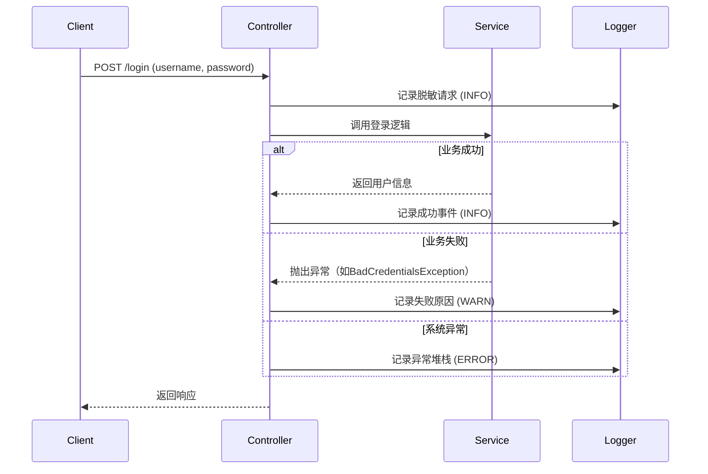

在Spring Boot应用中，Controller层处理登录/注册请求时，日志记录需兼顾**关键信息追踪**、**安全合规**和**故障排查**。以下是行业常见实践和基本步骤：

---

### **一、核心日志原则**
1. **敏感信息脱敏**  
   **禁止记录密码、身份证、手机号等敏感信息**，必须脱敏处理（如密码显示为`***`）。
2. **关键动作必记**  
   记录成功/失败事件、客户端信息（IP、设备）、时间戳。
3. **分级记录**  
   - `INFO`：正常流程（成功登录/注册）
   - `WARN`：业务异常（密码错误、用户已存在）
   - `ERROR`：系统异常（数据库连接失败、空指针）
4. **结构化日志**  
   使用JSON格式（如Logback+Logstash），便于ELK/Splunk分析。

---

### **二、登录/注册Controller日志示例**
#### **1. 请求入口日志（INFO级别）**
```java
@PostMapping("/login")
public ResponseEntity<?> login(@RequestBody LoginRequest request, HttpServletRequest httpRequest) {
    String clientIp = httpRequest.getRemoteAddr();
    // 脱敏：密码字段替换为 ***
    String safeRequest = request.toString().replace(request.getPassword(), "***"); 
    
    log.info("LOGIN_REQUEST | ip={} | params={}", clientIp, safeRequest);
    
    // ...业务逻辑
}
```
**日志输出**：  
`2026-01-05 14:30:00 [http-nio-8080] INFO AuthController - LOGIN_REQUEST | ip=192.168.1.100 | params=LoginRequest(username=user123, password=***)`

#### **2. 业务结果日志**
- **成功场景（INFO）**：
  ```java
  log.info("LOGIN_SUCCESS | user_id={} | username={} | ip={}", 
           user.getId(), user.getUsername(), clientIp);
  ```
- **失败场景（WARN）**：
  ```java
  log.warn("LOGIN_FAIL | username={} | ip={} | reason={}", 
           request.getUsername(), clientIp, "INVALID_CREDENTIALS");
  ```
- **注册冲突（WARN）**：
  ```java
  log.warn("REGISTER_FAIL | username={} | ip={} | reason={}", 
           request.getUsername(), clientIp, "USERNAME_ALREADY_EXISTS");
  ```

#### **3. 异常日志（ERROR级别）**
```java
try {
    // ...业务代码
} catch (DataAccessException e) {
    log.error("DB_ERROR | action=LOGIN | ip={} | username={}", 
              clientIp, request.getUsername(), e); // 记录异常堆栈
} catch (Exception e) {
    log.error("SYSTEM_ERROR | action=REGISTER | ip={}", clientIp, e);
}
```

---

### **三、关键步骤与安全实践**
#### **基本流程**


#### **必须包含的日志字段**
| 字段          | 说明                          | 示例值                     |
|---------------|-------------------------------|---------------------------|
| `action`      | 动作类型                      | `LOGIN_SUCCESS`           |
| `user_id`     | 用户ID（成功时）              | `12345`                   |
| `username`    | 用户名（脱敏）                | `user***`                 |
| `client_ip`   | 客户端IP                      | `203.0.113.42`            |
| `device_info` | 设备/浏览器信息（可选）       | `Mozilla/5.0 (Windows)`   |
| `error_code`  | 错误码（如`AUTH_001`）        | `INVALID_CREDENTIALS`     |
| `duration`    | 请求耗时（ms）                | `42`                      |

---

### **四、高级实践建议**
1. **自动脱敏工具**  
   使用注解实现全局脱敏（示例）：
   ```java
   @Target(ElementType.METHOD)
   @Retention(RetentionPolicy.RUNTIME)
   public @interface Loggable {
       boolean maskPassword() default true;
   }

   // AOP切面处理
   @Around("@annotation(loggable)")
   public Object logMethod(ProceedingJoinPoint joinPoint, Loggable loggable) {
       // 自动将@RequestBody中password字段替换为***
   }
   ```

2. **防暴力破解日志**  
   记录高频失败请求，供安全系统分析：
   ```java
   if (loginFailCount > 5) {
       log.warn("BRUTE_FORCE_ATTEMPT | ip={} | username={}", clientIp, username);
   }
   ```

3. **审计日志分离**  
   将安全相关日志（登录/注册）写入独立文件：
   ```xml
   <!-- logback-spring.xml -->
   <appender name="AUDIT" class="ch.qos.logback.core.rolling.RollingFileAppender">
       <file>logs/audit.log</file>
       <filter class="ch.qos.logback.core.filter.EvaluatorFilter">
           <evaluator>
               <expression>message.contains("LOGIN_") || message.contains("REGISTER_")</expression>
           </evaluator>
           <onMatch>ACCEPT</onMatch>
       </filter>
   </appender>
   ```

4. **合规性要求**  
   - 符合GDPR/CCPA：避免记录个人身份信息（PII）
   - 金融行业：满足等保2.0三级要求，保留日志180天以上

---

### **五、反面案例（绝对避免）**
```java
// 错误1：记录明文密码
log.info("Password: {}", request.getPassword()); 

// 错误2：记录完整用户对象（含敏感字段）
log.debug("User details: {}", user); 

// 错误3：异常堆栈暴露内部信息
catch (Exception e) {
    log.error(e.getMessage()); // 未记录堆栈且暴露细节
}
```

> **重要提示**：生产环境应通过配置关闭DEBUG日志（`application-prod.yml`中设置`logging.level.root=INFO`）。

---

通过以上实践，可构建**安全、可追溯、易分析**的登录/注册日志体系，同时满足运维监控和安全审计需求。实际项目中建议结合Spring AOP和自定义注解实现日志逻辑复用。