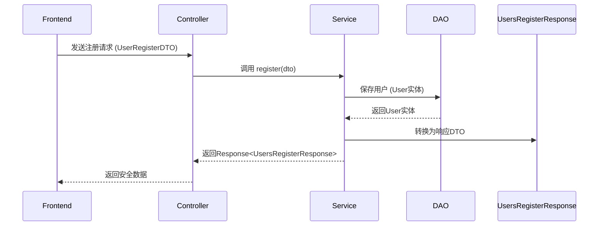

### 🔍 `dto` 层的作用解析（以 `UsersRegisterResponse` 为例）

#### 📌 1. **DTO 的核心定位**
- **全称**：Data Transfer Object（数据传输对象）
- **核心作用**：**在不同层之间安全传输数据**，避免直接暴露数据库实体
- **关键价值**：
  - ✅ **安全隔离**：防止敏感字段（如密码）被意外返回
  - ✅ **字段定制**：按前端需求组装数据（如脱敏、格式化）
  - ✅ **版本控制**：API 变更时不影响实体层

---

### 🧱 为什么需要 `UsersRegisterResponse`？
#### 普通写法（**危险！**）
```java
// Controller 直接返回实体类 → 会暴露密码等敏感字段
return userService.register(dto); // 返回 User 实体
```
**后果**：  
```json
{
  "id": 1,
  "username": "张三",
  "password": "$2a$10$abc...xyz", // ⚠️ 密码哈希值被返回！
  "phone": "13800138000"
}
```

#### 正确写法（**安全！**）
```java
// Controller 返回专门的响应DTO
return Response.success(UsersRegisterResponse.from(user));
```
**结果**：  
```json
{
  "code": 200,
  "message": "操作成功",
  "data": {
    "userId": 1,
    "username": "张三",
    "level": "新手",
    "registerTime": "2026-01-08 14:30:00" // 脱敏后的时间
  }
}
```

---

### 🛠️ `UsersRegisterResponse` 的典型实现
```java
package com.ai_platform.stuliu.aiplatform.dto;

import com.ai_platform.stuliu.aiplatform.entity.User;
import lombok.Data;

/**
 * 用户注册响应DTO (仅返回前端需要的安全数据)
 */
@Data
public class UsersRegisterResponse {
    private Long userId;
    private String username;
    private String level;
    private String registerTime; // 格式化后的时间

    // 静态工厂方法：从User实体构建响应对象
    public static UsersRegisterResponse from(User user) {
        UsersRegisterResponse response = new UsersRegisterResponse();
        response.setUserId(user.getId());
        response.setUsername(user.getUsername());
        response.setLevel(user.getLevel());
        response.setRegisterTime(
            user.getCreateTime().format(DateTimeFormatter.ofPattern("yyyy-MM-dd HH:mm:ss"))
        );
        return response;
    }
}
```

---

### 🔄 在注册流程中的使用位置


---

### ⚠️ 为什么不能直接用实体类？
| 场景                | 用实体类 `User` | 用响应DTO `UsersRegisterResponse` |
|---------------------|-----------------|----------------------------------|
| **密码字段**        | ❌ 会返回哈希值  | ✅ 完全不包含                   |
| **手机号**          | ❌ 明文返回     | ✅ 可脱敏返回 (138****8000)     |
| **数据库字段变更**  | ⚠️ 前端可能崩溃 | ✅ 仅影响DTO转换逻辑            |
| **字段格式化**      | ❌ 需前端处理   | ✅ 后端直接返回友好格式         |

---

### 🌟 实际代码示例（Service层）
```java
// UserServiceImpl.java
public Response<?> register(UserRegisterDTO dto) {
    // ... 业务逻辑
    
    // 创建安全响应对象（关键！）
    UsersRegisterResponse response = UsersRegisterResponse.from(user);
    
    return Response.success(response);
}
```

---

### 📌 企业级最佳实践
1. **DTO 分层设计**  
   - `request` 包：存放请求 DTO（如 `UserRegisterDTO`）
   - `response` 包：存放响应 DTO（如 `UsersRegisterResponse`）
   - 避免混用 → 严格区分输入/输出

2. **自动转换工具**  
   ```java
   // 使用 MapStruct 简化转换
   @Mapper
   public interface UserMapper {
       UsersRegisterResponse toRegisterResponse(User user);
   }
   ```

3. **前端需求驱动**  
   ```java
   // 仅返回前端需要的字段
   public class UsersRegisterResponse {
       private Long userId; // 前端需要ID做后续操作
       private String nickname; // 前端展示用
       // ❌ 不包含 gender/phone 等敏感字段
   }
   ```

---

### 💡 一句话总结
> **`dto` 层是前后端数据交互的「安全检查站」**  
> - 前端传入的数据 → 通过 **Request DTO** 验证清洗  
> - 后端返回的数据 → 通过 **Response DTO** 脱敏组装  
> - **永远不要让数据库实体直接暴露给前端！**

**需要我提供 `UserRegisterDTO`（请求DTO）的完整实现吗？** 这是注册接口的另一半关键组件。