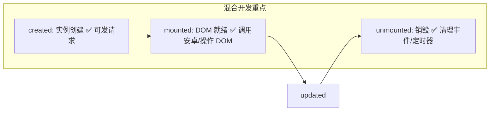
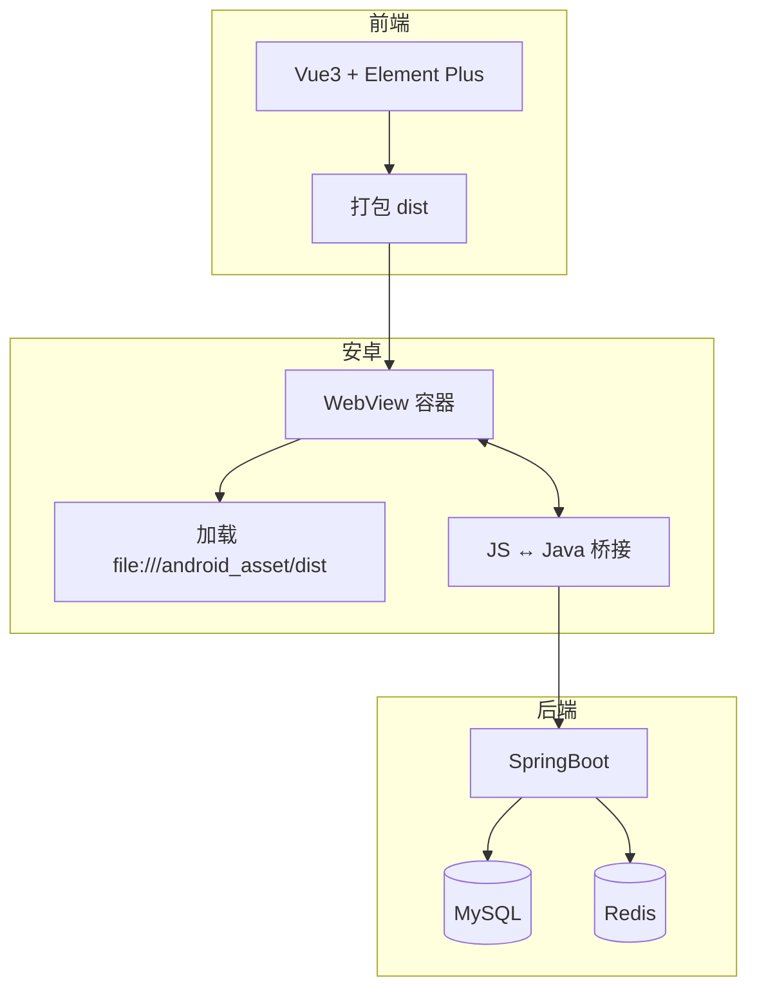

# Vue3 + Element Plus + 安卓混合开发 · Obsidian 优化版笔记

> [!INFO] 笔记元数据
> - 标签：#Vue3 #ElementPlus #Android #HybridDev #前端 #移动端
> - 创建日期：{{date}}
> - 最后更新：{{date}}
> - 适用场景：混合开发实战 / 面试复习 / 快速查阅

---

## 一、🎯 Vue3 基础语法（核心）

### 1.1 模板插值与指令速查表

| 指令 | 作用 | 混合开发注意 |
|------|------|-------------|
| `{{ }}` | 文本插值 | 避免在 WebView 中渲染大量未转义内容 |
| `v-model` | 表单双向绑定 | 与安卓输入框交互时注意同步时机 |
| `v-if / v-else` | 条件渲染（销毁重建） | 频繁切换建议用 `v-show` 提升性能 |
| `v-show` | 显示隐藏（CSS 切换） | WebView 中更轻量，推荐用于 Tab 切换 |
| `v-for` | 列表渲染 | **必须加 `:key`**，否则安卓端可能渲染异常 |
| `v-bind(:)` | 属性动态绑定 | 动态设置 `src` 时注意相对路径问题 |
| `v-on(@)` | 事件绑定 | 触摸事件在安卓需测试 `@click` 延迟 |

### 1.2 Options API 配置项模板
```js
export default {
  data() {
    return {
      msg: "hello",
      list: []
    }
  },
  methods: {
    async fetchData() {
      // 调用接口
    }
  },
  computed: {
    // 计算属性（带缓存，适合衍生数据）
    filteredList() {
      return this.list.filter(item => item.active)
    }
  },
  watch: {
    // 深度监听，适合表单联动/安卓回调监听
    'form.keyword'(newVal) {
      this.search(newVal)
    }
  }
}
```

### 1.3 生命周期（混合开发关键节点）🔑


> [!TIP] 安卓混合开发生命周期建议
> - **mounted** 中初始化 `window.android` 接口监听
> - **unmounted** 中移除全局事件，防止 WebView 复用导致内存泄漏
> - 页面返回时手动触发 `unmounted` 逻辑（安卓返回键拦截）

---

## 二、🧩 Vue 组件与通信

### 2.1 组件注册对比
```js
// 全局注册（main.js）- 适合基础组件
import ElButton from 'element-plus/es/components/button'
app.component('ElButton', ElButton)

// 局部注册 - 适合业务组件，利于按需加载
import MyHeader from './MyHeader.vue'
export default {
  components: { MyHeader }
}
```

### 2.2 组件通信方式全景图
```
1️⃣ 父→子：props（单向数据流，安卓传参常用）
2️⃣ 子→父：$emit + @event（表单提交回调）
3️⃣ 跨层级：provide/inject（主题配置/用户信息）
4️⃣ 全局状态：Pinia（✅ 推荐）/ 事件总线（⚠️ Vue3 已移除）
5️⃣ 原生交互：window.android / evaluateJavascript
```

### 2.3 自定义指令（安卓交互利器）
```js
// 全局指令：v-webview-ready
app.directive('webview-ready', {
  mounted(el, binding) {
    // WebView 加载完成后执行
    if (window.android) {
      binding.value?.()
    }
  }
})

// 使用
<template>
  <div v-webview-ready="onAndroidReady">内容</div>
</template>
```

---

## 三、🎨 Element Plus 组件库集成

### 3.1 安装方案对比
| 方案 | 命令 | 体积 | 推荐场景 |
|------|------|------|---------|
| 完整引入 | `app.use(ElementPlus)` | ~10MB | 快速原型/安卓本地包无压力 |
| 按需引入 | `unplugin-vue-components` | ~2MB | 生产环境/网络加载场景 ✅ |

### 3.2 按需引入配置（vite.config.js）
```js
import AutoImport from 'unplugin-auto-import/vite'
import Components from 'unplugin-vue-components/vite'
import { ElementPlusResolver } from 'unplugin-vue-components/resolvers'

export default {
  plugins: [
    AutoImport({ resolvers: [ElementPlusResolver()] }),
    Components({ resolvers: [ElementPlusResolver()] })
  ]
}
```

---

## 四、📦 Element Plus 高频组件速查

### 4.1 表单组件组合模板（含校验）
```vue
<template>
  <el-form 
    :model="form" 
    :rules="rules" 
    ref="formRef"
    label-position="top"
  >
    <!-- 输入框 -->
    <el-form-item label="账号" prop="username">
      <el-input 
        v-model="form.username" 
        placeholder="请输入账号"
        clearable
        @input="onInput"
      />
    </el-form-item>
    
    <!-- 密码框 -->
    <el-form-item label="密码" prop="password">
      <el-input 
        v-model="form.password" 
        type="password" 
        show-password 
      />
    </el-form-item>
    
    <!-- 单选 -->
    <el-form-item label="性别" prop="gender">
      <el-radio-group v-model="form.gender">
        <el-radio label="male">男</el-radio>
        <el-radio label="female">女</el-radio>
      </el-radio-group>
    </el-form-item>
    
    <!-- 提交按钮 -->
    <el-form-item>
      <el-button type="primary" @click="submitForm">提交</el-button>
      <el-button @click="resetForm">重置</el-button>
    </el-form-item>
  </el-form>
</template>

<script setup>
import { ref } from 'vue'
import { ElMessage } from 'element-plus'

const formRef = ref()
const form = ref({ username: '', password: '', gender: 'male' })

const rules = {
  username: [
    { required: true, message: '请输入账号', trigger: 'blur' },
    { min: 3, max: 20, message: '长度3-20位', trigger: 'blur' }
  ],
  password: [
    { required: true, message: '请输入密码', trigger: 'blur' }
  ]
}

const submitForm = async () => {
  try {
    await formRef.value.validate()
    // ✅ 校验通过，调用安卓或发请求
    window.android?.onLoginSuccess?.(JSON.stringify(form.value))
  } catch (err) {
    ElMessage.error('表单校验失败')
  }
}

const resetForm = () => {
  formRef.value?.resetFields()
}
</script>
```

### 4.2 安卓适配小贴士
```css
/* 防止软键盘遮挡输入框 */
.el-input__wrapper {
  transition: margin-bottom 0.3s;
}

/* WebView 中滚动优化 */
.el-scrollbar__wrap {
  overflow-x: hidden;
  -webkit-overflow-scrolling: touch; /* iOS 平滑滚动 */
}
```

---

## 五、🌐 Axios 网络请求封装（混合开发版）

### 5.1 标准封装（request.js）
```js
import axios from 'axios'
import { ElMessage } from 'element-plus'

const service = axios.create({
  baseURL: import.meta.env.VITE_API_BASE || '/api',
  timeout: 10000,
  headers: { 'Content-Type': 'application/json' }
})

// 请求拦截：统一加 token + 安卓设备信息
service.interceptors.request.use(config => {
  const token = localStorage.getItem('token')
  if (token) config.headers.Authorization = `Bearer ${token}`
  
  // 混合开发：注入安卓设备参数
  if (window.android?.getDeviceInfo) {
    const device = JSON.parse(window.android.getDeviceInfo())
    config.headers['X-Device-Model'] = device.model
  }
  return config
})

// 响应拦截：统一错误处理
service.interceptors.response.use(
  res => {
    const { code, message, data } = res.data
    if (code === 200) return data
    
    // 业务错误
    ElMessage.error(message || '请求失败')
    // token 过期 → 跳转登录（安卓原生页面）
    if (code === 401) window.android?.toLogin?.()
    return Promise.reject(new Error(message))
  },
  err => {
    // 网络错误
    if (!navigator.onLine) {
      ElMessage.warning('网络已断开')
      // 通知安卓显示离线页
      window.android?.showOffline?.()
    }
    return Promise.reject(err)
  }
)

export default service
```

### 5.2 Vite 跨域代理（开发环境）
```js
// vite.config.js
export default {
  server: {
    proxy: {
      '/api': {
        target: 'http://192.168.1.100:8080', // 本地后端地址
        changeOrigin: true,
        secure: false,
        rewrite: path => path.replace(/^\/api/, '')
      }
    },
    // 安卓真机调试：允许局域网访问
    host: '0.0.0.0',
    port: 3000
  }
}
```

> [!WARNING] 生产环境注意
> - 打包后 `baseURL` 应指向线上接口
> - 安卓 WebView 加载本地文件时，CORS 策略可能失效，需后端配置 `Access-Control-Allow-Origin: *`

---

## 六、🗄️ MySQL 数据库（后端支撑）

### 6.1 用户表设计（混合开发示例）
```sql
CREATE TABLE `user` (
  `id` INT PRIMARY KEY AUTO_INCREMENT,
  `username` VARCHAR(50) NOT NULL UNIQUE COMMENT '账号',
  `password` VARCHAR(100) NOT NULL COMMENT 'BCrypt 加密',
  `phone` VARCHAR(20) COMMENT '手机号',
  `avatar` VARCHAR(255) COMMENT '头像 URL',
  `device_id` VARCHAR(64) COMMENT '安卓设备 ID',
  `last_login` DATETIME COMMENT '最后登录时间',
  `created_at` TIMESTAMP DEFAULT CURRENT_TIMESTAMP,
  INDEX idx_device (`device_id`),
  INDEX idx_phone (`phone`)
) ENGINE=InnoDB DEFAULT CHARSET=utf8mb4;
```

### 6.2 高频 SQL 速查
```sql
-- 🔐 登录验证（联合查询）
SELECT id, username, avatar 
FROM user 
WHERE username = ? AND password = ? 
LIMIT 1;

-- 📱 设备绑定（防止重复注册）
INSERT INTO user (username, password, device_id)
VALUES (?, ?, ?)
ON DUPLICATE KEY UPDATE last_login = NOW();

-- 🔄 分页查询（安卓列表下拉刷新）
SELECT * FROM article 
WHERE status = 1 
ORDER BY created_at DESC 
LIMIT ?, ?;  -- 参数：offset, pageSize
```

---

## 七、⚡ Redis 缓存（性能优化）

### 7.1 混合开发缓存策略
```
✅ 适合缓存的场景：
├─ 用户 Token（String，EX 7d）
├─ 短信验证码（String，EX 5m）
├─ 首页轮播图（Hash，EX 1h）
├─ 用户权限列表（Set，EX 30m）
└─ 排行榜数据（ZSet，EX 10m）

❌ 不适合缓存：
├─ 实时性要求极高的数据（如库存）
├─ 大文件/图片（用 CDN）
└─ 频繁变更的配置（直接查库）
```

### 7.2 常用命令速查表
| 类型 | 命令示例 | 混合开发用途 |
|------|---------|-------------|
| String | `SET token:uid123 "abc" EX 604800` | 用户登录态 |
| Hash | `HSET user:123 name "zs" avatar "url"` | 用户信息缓存 |
| List | `LPUSH msg:uid123 "{...}"` + `LTRIM 0 99` | 消息队列（离线推送） |
| Set | `SADD perm:admin "user:add"` | 权限校验 |
| ZSet | `ZADD rank 100 "uid123"` + `ZREVRANGE 0 9` | 积分排行榜 |

---

## 八、🤖 安卓 + Vue 混合开发（核心实战）

### 8.1 架构流程图


### 8.2 安卓 WebView 关键配置（AndroidManifest.xml + Java）
```xml
<!-- AndroidManifest.xml -->
<application
    android:usesCleartextTraffic="true"  <!-- ✅ 允许 HTTP（调试用） -->
    android:hardwareAccelerated="true">   <!-- ✅ 开启硬件加速 -->
    
    <activity
        android:name=".MainActivity"
        android:windowSoftInputMode="adjustResize"> <!-- ✅ 防键盘遮挡 -->
    </activity>
</application>
```

```java
// MainActivity.java - WebView 初始化
WebView webView = findViewById(R.id.webview);
WebSettings settings = webView.getSettings();

// ✅ 必开配置
settings.setJavaScriptEnabled(true);
settings.setAllowFileAccess(true);
settings.setDomStorageEnabled(true);  // 支持 localStorage
settings.setCacheMode(WebSettings.LOAD_DEFAULT); // 缓存策略

// ✅ 混合开发优化
settings.setMixedContentMode(WebSettings.MIXED_CONTENT_ALWAYS_ALLOW);
webView.setWebChromeClient(new WebChromeClient()); // 支持 alert/console

// ✅ 注入 JS 接口（注意：API 26+ 推荐用 evaluateJavascript）
webView.addJavascriptInterface(new JsBridge(this), "android");

// 加载本地资源
webView.loadUrl("file:///android_asset/dist/index.html");

// ✅ 返回键处理：WebView 历史回退
@Override
public void onBackPressed() {
    if (webView.canGoBack()) {
        webView.goBack();
    } else {
        super.onBackPressed();
    }
}
```

### 8.3 JS ↔ 安卓 双向通信模板

#### 🔹 Vue 调用安卓（推荐封装）
```js
// utils/android.js
export const android = {
  // 安全调用：判断接口是否存在
  call(method, ...args) {
    if (window.android?.[method]) {
      try {
        // 参数自动 JSON 序列化
        const params = args.map(arg => 
          typeof arg === 'object' ? JSON.stringify(arg) : String(arg)
        )
        return window.android[method](...params)
      } catch (e) {
        console.error('[Android Bridge Error]', e)
      }
    } else {
      console.warn(`[Android] 方法 ${method} 未定义`)
    }
  },
  
  // 常用方法封装
  showToast: (msg) => android.call('showToast', msg),
  toLogin: () => android.call('toLogin'),
  getDeviceInfo: () => JSON.parse(android.call('getDeviceInfo') || '{}')
}
```

#### 🔹 安卓提供接口（Java 端）
```java
// JsBridge.java
public class JsBridge {
    private Context context;
    
    public JsBridge(Context ctx) { this.context = ctx; }
    
    @JavascriptInterface  // ✅ 必须加此注解
    public void showToast(String msg) {
        new Handler(Looper.getMainLooper()).post(() -> 
            Toast.makeText(context, msg, Toast.LENGTH_SHORT).show()
        );
    }
    
    @JavascriptInterface
    public String getDeviceInfo() {
        JSONObject json = new JSONObject();
        try {
            json.put("model", Build.MODEL);
            json.put("version", Build.VERSION.RELEASE);
            json.put("brand", Build.BRAND);
        } catch (Exception e) {}
        return json.toString();
    }
}
```

#### 🔹 安卓调用 Vue（evaluateJavascript）
```java
// Java 端调用 Vue 方法
String jsCode = "window.vueCallbacks?.onPushMessage?.('"+ message +"')";
webView.evaluateJavascript(jsCode, value -> {
    // ✅ 可获取 JS 返回值（String 类型）
    Log.d("JS Result", value);
});
```

```js
// Vue 端注册回调（mounted 中）
onMounted(() => {
  window.vueCallbacks = {
    onPushMessage: (msg) => {
      ElNotification({ title: '新消息', message: msg, type: 'success' })
    }
  }
  // 通知安卓 Vue 已就绪
  window.android?.onVueReady?.()
})
```

### 8.4 混合开发高频问题解决方案
| 问题 | 现象 | 解决方案 |
|------|------|---------|
| ⚪ 白屏 | WebView 空白 | 1. 检查 `setJavaScriptEnabled(true)`<br>2. 用 `chrome://inspect` 远程调试<br>3. 捕获 `onReceivedError` 日志 |
| 🔐 跨域失败 | 请求被拦截 | 1. 后端加 CORS 头<br>2. 安卓端 `setAllowUniversalAccessFromFileURLs(true)`（⚠️ 仅调试） |
| ⌨️ 键盘遮挡 | 输入框被盖住 | 1. `windowSoftInputMode="adjustResize"`<br>2. 监听 `resize` 事件动态调整 `margin-bottom` |
| 🔙 返回逻辑错 | 按返回直接退出 | 重写 `onBackPressed`，优先 `webView.goBack()` |
| 🧠 内存泄漏 | 页面切换卡顿 | 1. `unmounted` 中移除全局监听<br>2. WebView 复用池管理<br>3. 大图用 `Bitmap.recycle()` |

---

## 九、🔄 完整开发流程（Checklist）

```markdown
## ✅ 前端开发
- [ ] Vue3 + Vite 初始化项目
- [ ] 按需引入 Element Plus
- [ ] 封装 Axios（含 token/设备参数）
- [ ] 开发页面：登录 / 列表 / 表单 / 个人中心
- [ ] 联调接口（Mock → 真实后端）
- [ ] `npm run build` 生成 dist

## ✅ 安卓集成
- [ ] assets/ 放入 dist 文件夹
- [ ] WebView 基础配置（JS/缓存/硬件加速）
- [ ] 实现 JsBridge 接口（登录/支付/分享）
- [ ] 处理返回键/键盘/网络状态
- [ ] 真机测试（不同 Android 版本）

## ✅ 后端支撑
- [ ] SpringBoot 接口开发（RESTful）
- [ ] MySQL 表设计 + 索引优化
- [ ] Redis 缓存 Token/验证码
- [ ] 全局异常处理 + 统一响应格式
- [ ] 部署测试环境（HTTPS 可选）

## ✅ 联调上线
- [ ] 安卓包签名 + 混淆配置
- [ ] 接口地址切换生产环境
- [ ] 灰度发布 + 崩溃监控（Firebase/Crashlytics）
- [ ] 用户反馈通道（安卓原生 + WebView 双入口）
```

---

## 十、🎓 高频考点 & 面试锦囊

### 🔥 必背知识点
1. **Vue3 生命周期**  
   → `created` 发请求，`mounted` 操作 DOM/调用安卓，`unmounted` 清理

2. **组件通信 5 种方式**  
   → props/$emit（基础）、provide/inject（跨层）、Pinia（全局）、JSBridge（原生）

3. **Element Plus 表单校验**  
   → `rules` 配置 + `ref.validate()` + 自定义验证器（手机号/密码强度）

4. **Axios 封装核心**  
   → 拦截器加 token、统一错误处理、安卓设备参数注入

5. **MySQL 优化**  
   → 索引原则（最左前缀）、`EXPLAIN` 分析、避免 `SELECT *`

6. **Redis 缓存策略**  
   → 缓存穿透（布隆过滤器）、雪崩（随机过期）、击穿（互斥锁）

7. **WebView 安全**  
   → `addJavascriptInterface` 仅限 API 17+、过滤输入防 XSS、HTTPS 校验

### 💡 混合开发加分项
```js
// 1. 离线包更新方案
if (window.android?.checkUpdate) {
  const localVer = localStorage.getItem('app_version')
  const serverVer = await window.android.checkUpdate()
  if (serverVer > localVer) {
    // 下载新 dist → 替换 assets → reload WebView
  }
}

// 2. 性能监控上报
window.addEventListener('load', () => {
  const timing = performance.timing
  const loadTime = timing.loadEventEnd - timing.navigationStart
  window.android?.reportPerformance?.(JSON.stringify({
    page: location.pathname,
    loadTime,
    ua: navigator.userAgent
  }))
})

// 3. 热修复预留接口
window.__fix__ = (code) => {
  try { new Function(code)() } 
  catch(e) { console.error('Hot fix failed', e) }
}
```
